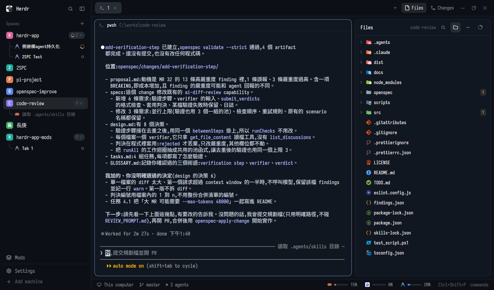

# Herdr Spaces Tree

An elegant hierarchical tree sidebar and smart conversation manager for the **[Herdr app](https://github.com/herdr/herdr-app)**.



Organize your workspaces and AI coding agents (**Claude Code**, **Antigravity / Gemini**, **Codex**, **Pi**, and custom CLIs) in a unified, hierarchical tree view with curved guide rails, session persistence, and one-click smart conversation resumption.

---

## 🌟 Features

- **🌲 Hierarchical Space > Agent Tree**:
  - Automatically nests running and dormant agents under their owning workspace Space.
  - Smooth curved rounded-corner tree guide rails (`╰─`) connecting Spaces to Agents with zero visual clutter.
  - Expand / collapse per space with smooth state retention.
- **⚡ Smart Conversation Resumption (`Resume` / `Click-to-Wake`)**:
  - Distinguishes between **Active Running Agents** (solid status indicators) and **Dormant Sessions** (dimmed text when CLI exits back to shell).
  - Clicking a dormant session intelligently wakes it up by resuming the conversation:
    - **Claude Code**: `claude --resume <id>` or `claude --continue`
    - **Antigravity**: `agy --conversation <id>` or `agy --continue`
    - **Codex / Pi / Generic**: runs configured resume flags or launches in-place.
- **🧹 Dotted Facts & Clean Typography**:
  - Agent titles are clean and readable without intrusive `#xxxxxx` session hashes.
  - Shows custom session titles, branch information, and relative activity timestamps cleanly separated by middle dots (`·`).
- **🏷️ Capsule Counters & Refined Metrics**:
  - Spaces display a subtle capsule badge (`rounded(9)`, height `18px`) showing the number of active/recent sessions.
  - Pixel-perfect row heights (Space `31px`, Agent `27px`) aligned with Herdr native typography.
- **🗂️ Refined Collapsed Rail Mode (Dock View)**:
  - When the sidebar is narrowed or collapsed into a slim rail (e.g. 44px), it transforms into a modern icon dock.
  - Replaces bare numbers with colorful Space avatar badges (`[2]`, `[P]`, `[長]`, `[H]`, `[C]`).
  - Pixel-perfect vertical alignment with top toggle and action buttons (`pl(6)`).
  - Floating status indicators: live spinner for `working`, red dot for `blocked`, and agent count badges.
  - Active space is marked by an anchor indicator pill on the **right edge**, seamlessly connecting into the active editor canvas.
- **👻 Ghost Session Elimination**:
  - Live synchronization with `space.tabs` prevents stale or duplicate sessions from lingering when tabs are closed.
- **🧩 Companion Mod: `agent-tab-menu`**:
  - Replaces or augments the tab header dropdown with dual-mode launching:
    - **接續對話 (Resume)**: Continue the current space's latest conversation.
    - **開立新對話 (New Conversation)**: Start a fresh session with a single click.

---

## 🚀 Installation (Herdr Standard)

This mod suite strictly follows the **[Herdr App Mod Sharing Specification](https://github.com/herdr/herdr-app#layouts-and-mods-other-people-made)**.

### Method 1: Ask Your Agent (Official & Recommended)
Tell any AI coding agent working in Herdr:

> *"Add mod `s16777216/herdr-spaces-tree`"*
>
> or
>
> *"Install mod from `https://github.com/s16777216/herdr-spaces-tree`"*

Your agent will follow Herdr's official protocol:
1. Read `RECIPE.md` to inspect safety, permissions, and layout placement.
2. Copy `mods/spaces-tree/` and `mods/agent-tab-menu/` into your `~/.config/herdr-app/mods/`.
3. Verify both mods with `herdr-app check`.
4. Update your active layout JSON's sidebar block to use `"mod": "spaces-tree"`.

---

### Method 2: Manual Installation

#### 1. Copy Mod Folders
Clone or download this repository, then copy the mods into your Herdr configuration directory:

- **Windows**:
  - Copy `mods/spaces-tree` to `%USERPROFILE%\.config\herdr-app\mods\spaces-tree`
  - Copy `mods/agent-tab-menu` to `%USERPROFILE%\.config\herdr-app\mods\agent-tab-menu`
- **macOS / Linux**:
  - Copy `mods/spaces-tree` to `~/.config/herdr-app/mods/spaces-tree`
  - Copy `mods/agent-tab-menu` to `~/.config/herdr-app/mods/agent-tab-menu`

#### 2. Configure Your Layout
In your custom layout file (e.g. `~/.config/herdr-app/layouts/main-copy.json`), point the sidebar block to `spaces-tree`:

```json
{
  "id": "spaces",
  "type": "block",
  "content": {
    "mod": "spaces-tree"
  },
  "size": {
    "px": 240
  }
}
```

*(Optional)* To also use the companion tab menu, update your tab header or new menu configuration to point to `agent-tab-menu`.

#### 3. Verify
Run the official Herdr verification command:
```bash
herdr-app check ~/.config/herdr-app/mods/spaces-tree
herdr-app check ~/.config/herdr-app/mods/agent-tab-menu
```

---

## 🛠️ Repository Structure

```
herdr-spaces-tree/
├── RECIPE.md                 # Herdr specification recipe & design docs
├── preview.png               # Visual screenshot of the hierarchical tree
├── keys.json                 # Default keyboard shortcuts
├── README.md                 # Documentation
└── mods/
    ├── spaces-tree/          # Hierarchical spaces & agents tree sidebar
    │   ├── main.js
    │   ├── mod.json
    │   └── jsconfig.json
    └── agent-tab-menu/       # Companion tab header menu (Resume / New)
        ├── main.js
        ├── mod.json
        └── jsconfig.json
```

---

## 📄 License
MIT License. Feel free to use, customize, and share!
