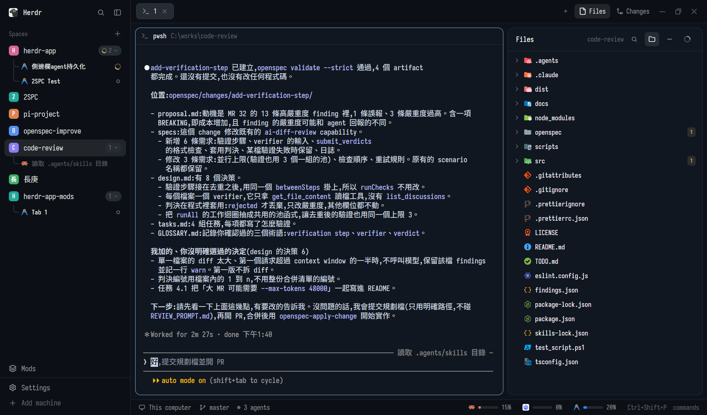

# Spaces Tree & Agent Tab Menu

An integrated hierarchical workspace sidebar and conversation lifecycle manager for the Herdr app. It organizes active and dormant AI coding agent sessions directly beneath their parent workspace Spaces using rounded tree guide rails, clean typography, and instant one-click session resumption (`Resume` / `Click-to-Wake`).

## What you see

The mod suite occupies the sidebar slot (`slot: "spaces"`, default width 240px, background `theme().chrome` / `theme().canvas`, border `theme().border`).

1. **Header (Top)**:
   - "Spaces" title (13px, font semibold, `theme().dim`).
   - Quick-add button (`+`) for creating new spaces or tabs.
2. **Space Row (Height 31px)**:
   - 20px colored workspace badge icon with initial letter (`H`, `2`, `P`, `C`, etc.).
   - Space name in 13px font semibold (`theme().foreground`).
   - Active branch / folder preview in subtle `theme().dim`.
   - Capsule counter pill (`rounded(9)`, height 18px, px 6, background `theme().surface`) displaying the session count and collapse indicator (e.g. `2 ▾`).
   - Selected state: highlighted background with accent left indicator or rounded active card.
3. **Curved Tree Rails (`╰─`)**:
   - Drawn using native GPUI elements (`border_l(1.5).border_b(1.5).rounded_bl(6)`).
   - Horizontal branch width: 11px, height: 14px, starting at left 16px.
   - Intermediate rows feature a vertical continuation line from top 13.5px to bottom 0px to connect seamlessly to subsequent siblings.
4. **Agent Row (Height 27px, nested under Space)**:
   - 14px AI Agent icon (Claude orange robot, Antigravity blue/purple chevron, Codex, Pi, or CLI icon).
   - Agent title / session custom name (without intrusive `#xxxxxx` hashes).
   - Clean dotted facts: relative timestamp (e.g. `12m`, `2h`) separated by subtle middle-dots (`·`).
   - Status indicators:
     - **Live Running Agent**: Bright white text (`theme().foreground`) and solid colored status dot (`working`, `idle`, `blocked`).
     - **Dormant Session**: Dimmed text (`theme().dim`) indicating the agent CLI exited back to shell.
5. **Sub-agent Rows (Height 25px, nested under Primary Agent)**:
   - Second-tier curved guide rails branching from parent agent (left(28)).
   - Discovers background worker subagents spawned via hc run (k.parent === parentAddress).
   - Dedicated sub tag, task brief name, and live status (working spinner / idle dot).
   - Left-click to focus pane or peek live output overlay (	erminal.peek).
   - Right-click for Sub-agent Menu: Peek, Keep as Pane (	erminal.keep), Copy Address, or Kill (	erminal.kill).
6. **Companion Mod: gent-tab-menu**:
   - Tab header dropdown providing quick access to:
     - **接續對話 (Resume)**: Launches `claude --resume <id>` / `claude --continue` or `agy --conversation <id>` / `agy --continue`.
     - **開立新對話 (New Conversation)**: Starts a fresh agent session.
7. **Collapsed Rail Mode (Dock View)**:
   - Activates when the sidebar width is < 160px (typically 44px).
   - Space Avatars: 20x20px colored avatar boxes (`rounded(6)`) centered inside 26x26px hitboxes.
   - Alignment: Left margin set to `pl(6)` so every avatar, action button (`+`), and top collapse toggle share the exact same vertical center line (X = 19px).
   - Right Active Indicator: Vertical accent capsule (`w: 3px, h: 16px, rounded_l(2)`) pinned to `right: 0`, visually anchoring the active space to the workspace canvas.
   - Dynamic Badges: Working spinner at top-right, blocked dot, and agent count badge (`rounded(6)`) at bottom-right with cutout background.

## How it behaves

- **Hierarchical Nesting**: Spaces expand to list all sessions attached to their active tabs. Clicking the space row selects the space, while clicking the chevron toggles expansion.
- **Smart Resumption (`Click-to-Wake`)**:
  - Clicking an active agent pane focuses its terminal immediately.
  - Clicking a dormant agent terminal sends the appropriate CLI resume flags:
    - Claude Code: `claude --resume <sessionId>` (or `claude --continue` if session id is unset).
    - Antigravity: `agy --conversation <conversationId>` (or `agy --continue`).
    - Others: launches CLI or shell in the space's working directory.
- **Ghost Session Filtering**:
  - Live sessions are cross-referenced with `space.tabs` (`validTabIds.has(s.tab)`).
  - Stale cached sessions whose tabs no longer exist are pruned automatically to avoid ghost duplicate rows.
- **Session Metadata Discovery**:
  - Reads agent OSC 7501 status and session IDs from terminal buffers and active processes.
  - Caches last-known session names and IDs in mod storage to provide instant labels even across restarts.

## Built from

- **GPUI Elements**: `v_flex`, `h_flex`, `div`, `svg`, `image`.
- **Herdr APIs**: `spaces`, `panes`, `terminals`, `theme`, `run`, `home`, `appHome`, `exec`, `props`, `shared`, `setShared`.
- **Companion Mod**: `agent-tab-menu` (companion dropdown for tab titlebars).

## Watch out

- **Layout Placement**: The mod replaces the default spaces sidebar. Ensure your layout JSON specifies `"content": { "mod": "spaces-tree" }` for the sidebar block.
- **CLI Availability**: Resume commands rely on `claude` or `agy` being available on the system PATH. If not found, a standard shell is opened in the space directory.
- **Windows Terminal Escaping**: Resume commands are sent cleanly to the terminal input stream without interfering with shell history.

## Done when

1. `herdr-app check mods/spaces-tree` exits with code 0.
2. `herdr-app check mods/agent-tab-menu` exits with code 0.
3. Spaces render with their nested agents connected by rounded curved tree rails (`╰─`).
4. Clicking a live agent focuses its terminal.
5. Clicking a dormant agent wakes the CLI with `--resume` / `--continue`.
6. Stale or closed tabs leave no phantom sessions behind.
